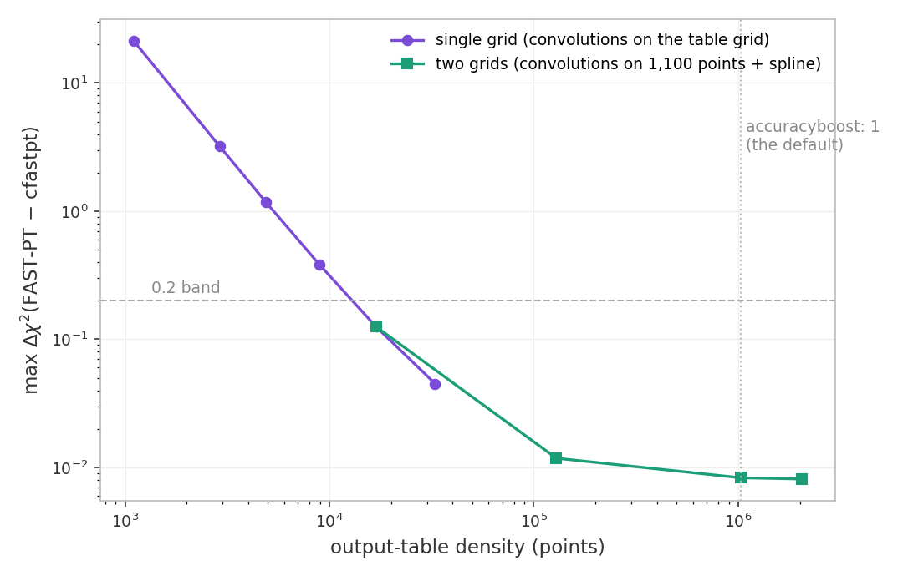
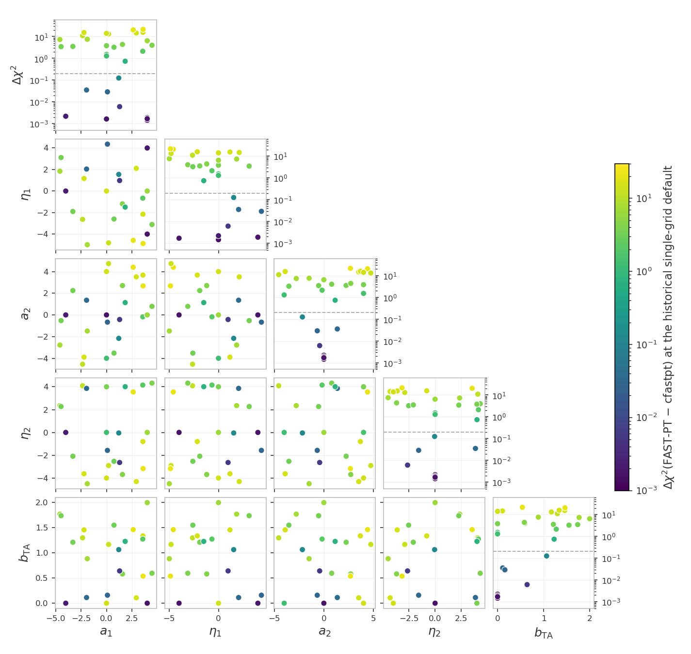
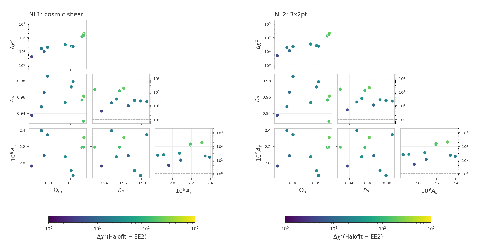
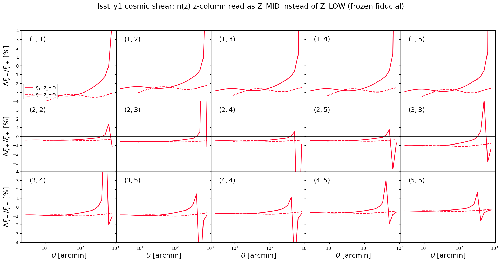
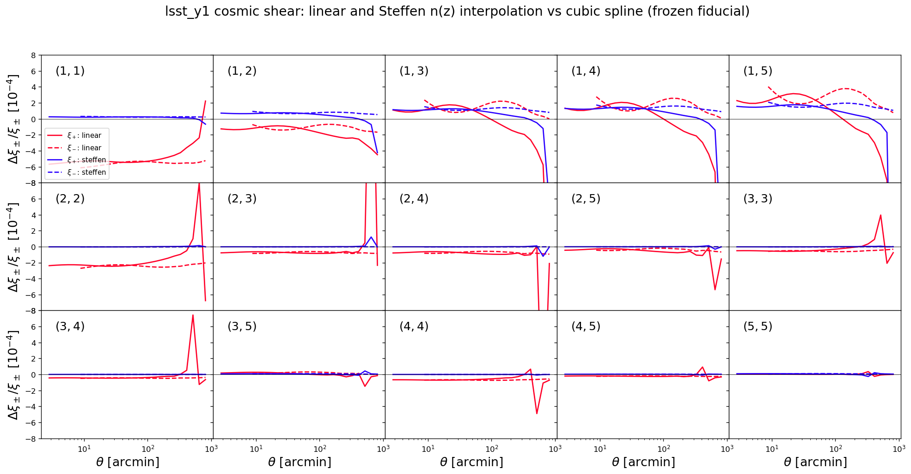
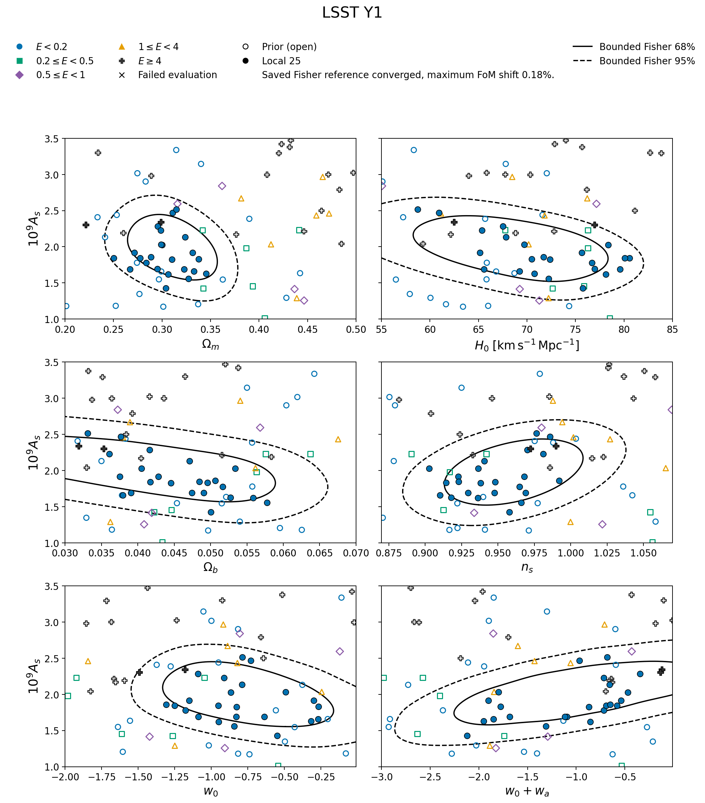
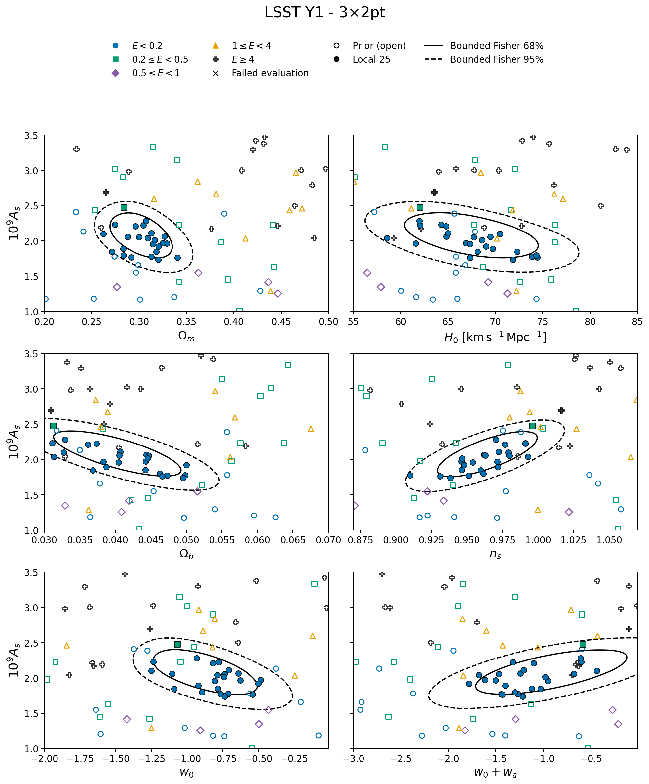

# Data-vector and likelihood tests

The frozen snapshot `frozen/` and its manifest `manifest_sha256.json`
live in the parent `tests/` directory; the paths below are relative to
it.

These tests catch two kinds of silent breakage: a $\chi^2$ that drifted
because code or data changed by accident, and a race condition (a bug
where evaluating several points in a row corrupts a later result
through leftover internal state or colliding OpenMP threads). These
tests also measure the accuracy of the hybrid emulated pipelines and
report whether they are accurate enough for data analysis (advisory:
no pass/fail).

The mechanism of every shared check family - the frozen-reference and
race contract, the zero-baseline construction, the sweeps and their
`--high`/`--mask` options, the accuracy settings and their meanings -
is documented once in
[the shared data-vector checks](https://github.com/CosmoLike/cocoa-cosmolike-core/blob/main/README.md#dv_checks)
of the CosmoLike core. This file records what LSST-Y1 runs and what it
measured.

# Table of contents

1. [Running the tests](#run_tests)
2. [The tests](#the_tests)
    1. [The CFASTPT vs FASTPT comparison](#cfastpt_fastpt)
    2. [The Halofit vs EE2 checks](#halofit_ee2)
    3. [The EE2 modification tests](#ee2_tests)
    4. [Advisory checks](#advisory_checks)
    5. [Scale-cut diagnostics](#scale_cut_diagnostics)
    6. [Accuracy checks](#accuracy_checks)
    7. [The N-random-models check](#nmodels_check)
    8. [Baryonic feedback checks](#baryon_checks)
    9. [The photo-z convention checks](#photoz_conventions)
    10. [The non-Limber checks](#nonlimber_checks)
    11. [The sector-ladder cache check](#cache_ladder)
    12. [The non-Limber early-exit tolerance checks](#nonlimber_tolerance)
3. [Hybrid-emulator accuracy test](#hybrid-emulator-accuracy-test)
4. [FoM convergence](#fom-convergence)
5. [Appendix](#appendix)
    1. [FAQ: What does this project's snapshot hold?](#frozen_copy)
    2. [FAQ: How can maintainers refresh the snapshot?](#refreeze)

## Running the tests <a name="run_tests"></a>

We assume users are in the Conda cocoa environment from a previous
`conda activate cocoa` command, that the shell is bash, and that the
current folder is the cocoa main folder `cocoa/Cocoa`. Every command
below assumes `start_cocoa.sh` has been sourced once:

    source start_cocoa.sh

Run the full suite with

    python -m pytest ./projects/lsst_y1/tests/data_vector

or, without pytest,

    python -m unittest discover -s ./projects/lsst_y1/tests/data_vector -v

The tests change no project files. Each test prints a progress line per
model build and per evaluation, then a report with the computed $\chi^2$,
the stored reference, the difference, and the pass limit. A full run
performs about 207 likelihood evaluations and takes a few minutes. The test
files set their OpenMP worker count before imports.

The shared likelihood tests default to four OpenMP workers. For six workers,
set `COCOA_TEST_OMP_THREADS=6` and `OMP_THREAD_LIMIT=6` before
starting Python. The entry points copy the test setting to
`OMP_NUM_THREADS` before importing native libraries. Keep BLAS at
one worker. A smaller OpenMP thread limit can reduce the actual team
below the requested count.

## The tests <a name="the_tests"></a>

The standard configurations get four tests each - the frozen-reference
drift check and the race check, in NLA and in TATT
([mechanism](https://github.com/CosmoLike/cocoa-cosmolike-core/blob/main/README.md#dv_frozen)).
The TATT variants set

    IA_model: 1
    LSST_A2_1: 0.05
    LSST_BTA_1: 0.05
    LSST_A2_2: -1.51541

The suite follows the shared
[test-file naming convention](https://github.com/CosmoLike/cocoa-cosmolike-core/blob/main/README.md#dv_naming): a file name
means the same thing in every project. This project's
configurations and test numbers:

| file | configuration | tests |
|---|---|---|
| `test_example1.py` | cosmic shear | 1-4 |
| `test_example2.py` | 3x2pt | 5-8 |
| `test_fastpt.py` | frozen FAST-PT references: shear, 3x2pt | 9, 10 |
| `test_example2_2x2pt.py` | 2x2pt (`lsst_y1.combo_2x2pt`) | 11-14 |
| `test_fastpt.py` | the sweep: shear; 3x2pt (`lsst_y1.combo_3x2pt`); 2x2pt (`lsst_y1.combo_2x2pt`) | 15, 16, 17 |
| `test_ee2.py` | modification pin; race | 18; 19 |

### The CFASTPT vs FASTPT comparison (`test_fastpt.py`, tests 15-17) <a name="cfastpt_fastpt"></a>

The sweep mechanism, the zero-baseline construction and the
`--high`/`--mask` options are in
[the shared checks](https://github.com/CosmoLike/cocoa-cosmolike-core/blob/main/README.md#dv_fastpt).
Here, test 15 runs it on cosmic shear, test 16 on the 3x2pt likelihood
and test 17 on the 2x2pt likelihood. In test 16 the frozen
configuration fixes the one-loop bias amplitudes (`LSST_B2_*`) at
zero, so the sweep scores the intrinsic-alignment tables alone on the
wider data vector; in test 17 the TATT tables are scored through
galaxy-galaxy lensing alone.

The LSST-Y1 scale-cut masks `--mask` accepts: `frozen` (the default)
keeps the M1 mask of the frozen contract (959 of the 1,560 data
points); `M2` to `M5` cut progressively more points (854, 749, 659,
569) and `M6` fewer (1,378); `ones` keeps every point.

#### Why the defaults are the converged configuration <a name="fastpt_minimum"></a>

This is a decision record, built from this check's own sweeps.

- Before the two-grid upgrade of the fastpt theory block (2026-09)
  there was no upsampling: one shared 1,100-point grid played both
  roles, and the difference against cfastpt reached
  $\Delta\chi^2 = 21$ across the intrinsic-alignment prior.
- Separating the two grids located the entire divergence in the
  density of the interpolated table and none of it in the
  convolutions.
- Raising the internal grid alone moves nothing (max
  $\Delta\chi^2 = 0.00830$ at 1,100 points, 0.00827 at 4,900, output
  fixed at the default): the convolutions were already accurate on
  their default grid, and the dense splined table removes the
  interpolation error at almost no cost.

Table measured on 2026-09-22 (cosmic shear, test 15):

| output table (points) | internal grid (points) | max $\Delta\chi^2$ | Runtime / first row |
|---|---|---|---|
| 1,100 | 1,100 (shared) | 21.40 | 1.00 |
| 16,900 | 1,100 | 0.125 | 1.00 |
| 128,900 | 1,100 | 0.0118 | 1.04 |
| 1,024,900 (`accuracyboost: 1`, the default) | 1,100 (the default) | 0.0082 | 1.33 |
| 2,048,900 (`accuracyboost: 2`) | 1,300 (`internal_accuracyboost: 2`) | 0.0080 | 1.62 |

Runtime ratios use the first row of this table as the baseline, with the
same timed scope and machine. They compare sampling costs within this
project; absolute runtimes depend on the machine.





Measured on 2026-09-23:

- Test 16 (3x2pt): max $\Delta\chi^2 = 0.00018$ at the defaults,
  $0.00008$ at the pushed camb/cosmolike settings - smaller than
  cosmic shear's 0.0082 at the same points under the 3x2pt masked
  covariance.
- Test 17 (2x2pt): max $\Delta\chi^2 = 0.00004$ at the defaults and
  $0.00001$ pushed, the mildest of the three, with the TATT tables
  entering through galaxy-galaxy lensing alone.
- b2-activated variant (exploratory, not a shipped test:
  `LSST_B2_* = 1.0` fixed in BOTH implementations, every other
  setting the frozen 3x2pt contract): the one-loop galaxy-bias
  tables the frozen configuration turns off measure max
  $\Delta\chi^2 = 0.044$, with a floor of 0.013 at the IA-off null
  where only the bias tables differ. Doubling the FAST-PT boosts
  moves nothing (0.044408 to 0.044394): a density-independent
  numerics difference between the two bias implementations, well
  inside the 0.2 limit.
- `--mask=ones` (no scale cuts, all 1,560 points weighted): every
  sweep still passes. Cosmic shear measures max
  $\Delta\chi^2 = 0.097$ at the default
  camb/cosmolike settings - twelve times its M1 value, insensitive
  to the FAST-PT boosts - and 0.00012 at the pushed settings: the
  unmasked small scales amplify cosmolike's default integration
  error, not a FAST-PT grid deficiency. 3x2pt and 2x2pt measure
  0.0029 and 0.0027 at the defaults, 0.0015 and 0.0014 pushed.

> [!NOTE]
> The fastpt defaults hold this accuracy on their own; raising the
> boosts is a convergence test, not a need. cfastpt (`IA_code: 0`)
> remains the reference implementation.

Run the comparison at the default and at the pushed camb/cosmolike
settings (the full comparison is both invocations):

    python -m pytest ./projects/lsst_y1/tests/data_vector/test_fastpt.py
    python -m pytest ./projects/lsst_y1/tests/data_vector/test_fastpt.py --high=1

### The Halofit vs EE2 checks (`test_nonlinear.py`, NL1-NL2) <a name="halofit_ee2"></a>

[Mechanism](https://github.com/CosmoLike/cocoa-cosmolike-core/blob/main/README.md#dv_halofit_ee2):
NL1 evaluates the cosmic-shear data vector and NL2 the 3x2pt one, each
with both nonlinear-power sources at the ten shared cosmologies.
Measured on 2026-09-23 (the figure below, frozen M1 mask):

- NL1 (cosmic shear): median $\Delta\chi^2$ 23.2, maximum 189.1;
  33.0 and 329.0 under `--mask=ones`.
- NL2 (3x2pt): median 25.4, maximum 204.0, largest at the
  high-omegam draws; median 4,292 and maximum 12,991 under
  `--mask=ones`.
- At the frozen cuts the shear block alone carries nearly the whole
  3x2pt disagreement, and the two nonlinear-P(k) sources are not
  interchangeable at this project's precision; without cuts the
  disagreement is dominated by the small scales the masks remove.



### The EE2 modification tests (`test_ee2.py`, tests 18-19) <a name="ee2_tests"></a>

[Mechanism](https://github.com/CosmoLike/cocoa-cosmolike-core/blob/main/README.md#dv_ee2):
test 18 pins the physics of Cocoa's EuclidEmulator2 modifications
against the pre-modification build (commit `ff59f66`); test 19 is the
race check with EE2 on. Measured on 2026-09-23:

- Test 18: max $\Delta\chi^2 = 8.6\times10^{-6}$ over the ten
  cosmologies (the modifications change no emulated physics).
- Test 19: the fresh and 10th-in-a-row fiducial agree to all eight
  printed decimals.

### Advisory checks (`test_emul2.py`, E1-E4) <a name="advisory_checks"></a>

These checks test the hybrid emulators: trained machine-learning
networks replace the Boltzmann code. There is no pass/fail; each
check prints four quantities:

| printed quantity | meaning |
|---|---|
| emulator $\chi^2$ | the emulated pipeline evaluated at the fiducial point |
| drift | change against the stored emulator reference; nonzero means the installed emulator no longer reproduces its stored $\chi^2$ |
| $\lvert\chi^2_\text{emulator} - \chi^2_\text{non-emulated}\rvert$ | the difference against the non-emulated $\chi^2$ at the same cosmology |
| verdict | agrees at this configuration when $\lvert\chi^2_\text{emulator} - \chi^2_\text{non-emulated}\rvert < 0.2$, does not agree otherwise |

A race-condition check (OpenMP threading) runs as well, warning
instead of failing.

> [!NOTE]
> The trained-network files are read from
> `external_modules/data/emultrf`, not from the `frozen/` snapshot; the
> network device is pinned to `cpu` so the numbers do not depend on
> GPU availability.

Run them on their own:

    python -m pytest ./projects/lsst_y1/tests/data_vector/test_emul2.py

### Scale-cut diagnostics (`test_scale_cut_diagnostics.py`) <a name="scale_cut_diagnostics"></a>

The scale-cut diagnostics of 2011.06469 eq 17 — dlnC_ss/dlnk,
dlnxi_pm/dlnk, and the response functions rf_C_ss and rf_xi — are
notebook-facing functions with no role in the likelihood, so this
test is their only automated coverage. It checks, in one process on
the frozen TATT cosmic-shear fiducial, that every scalar and array
overload returns finite values, that the scalar overloads agree with
the matching array entries (they share the batch engines), and that
the response functions behave as normalized cumulative fractions.

The multipoles $\ell \le 20$ take a separate low-$`\ell`$ branch of
rf_C_ss. If $k$ underflowed to zero inside its normalization integrand
there, a guard would stop the process with `exit(1)`, which also kills
a Jupyter kernel running the notebook derivative cells; the test
evaluates $\ell = 3$ and 10 to keep that branch under check.

### Accuracy checks (`test_accuracy.py`, A1-A6) <a name="accuracy_checks"></a>

[Mechanism, setting meanings and cost order](https://github.com/CosmoLike/cocoa-cosmolike-core/blob/main/README.md#dv_accuracy):
check A0 scans one setting at a time on the 3x2pt NLA configuration
(including `accuracyboost: 5` as a stress test); A1-A6 re-evaluate
cosmic shear, 3x2pt and 2x2pt, in NLA and TATT, with every setting
pushed at once. This project's pushed values:

| setting | raised to |
|---------|-----------|
| `accuracyboost` (cosmolike) | 3 |
| `integration_accuracy` (cosmolike) | 10 |
| `internal_accuracyboost` (cosmolike) | 2 |
| `lmax` (cosmolike) | 200000 |
| `kmax_boltzmann` (cosmolike) | 40 |
| `AccuracyBoost` (CAMB) | 2 |
| `k_per_logint` (CAMB) | 50 |
| `kmax` (CAMB) | 50 |

Every likelihood yaml of this project and the notebook wrappers set
`internal_accuracyboost: 1.0`, the exact single-grid path; the C
library's own default, 0.5 (`structs.c`), applies only where no
caller sets it.

- 2026-09-25: the lsst_y1 scan measured
  $\Delta^T C^{-1} \Delta \le 10^{-9}$ against the single-grid path
  down to 0.27.

Run them on their own, or skip them (high-accuracy evaluations take
minutes):

    python -m pytest ./projects/lsst_y1/tests/data_vector/test_accuracy.py
    python -m pytest ./projects/lsst_y1/tests/data_vector --ignore ./projects/lsst_y1/tests/data_vector/test_accuracy.py

### The N-random-models check <a name="nmodels_check"></a>

[Mechanism](https://github.com/CosmoLike/cocoa-cosmolike-core/blob/main/README.md#dv_nmodels):
50 seeded random points across the 3x2pt NLA prior, each scored with
every setting of the A-checks pushed at once against its own
default-settings vector. Model $m$ draws its point with the seed
$137 + m$, so every run repeats the same points and the same figure.
The pushed-settings vectors are stored in
`tests/frozen/nmodels_example2.npz`, so a run builds one model at the
default settings and evaluates the 50 points. The check runs with the
rest of `test_accuracy.py`, or on its own with

    python -m pytest ./projects/lsst_y1/tests/data_vector/test_accuracy.py -k nmodels

After a change to the prior, the draw settings, the fiducial, a pushed
setting or a likelihood default, the check fails until the stored
vectors are regenerated (without a stored file it is skipped with the
same instruction):

    python ./projects/lsst_y1/tests/generate_frozen_reference.py --nmodels

`COCOA_ACCURACY_NMODELS_FIGURES` names the folder of the figure
(unset: the system temporary folder, so the run changes no project
file).

The check is advisory: each $\Delta\chi^2$ only has to be finite. Three
settings in `tests/cocoa_test_utils.py` shape the draw:

- `NMODELS_BOX`: $\Omega_m$ is drawn in $[0.2, 0.5]$ and $w_0 + w_a$
  in $[-3, -0.01]$, the boxes of the examples. The frozen
  configurations keep the earlier, wider boxes, and the override
  narrows them without a refreeze; it changes only those values of a
  seeded point.
- `NMODELS_HOLD`: every second model (seed 138, 140, ...) resets
  $\Omega_m$, $A_s$ and the lens biases to the fiducial after its draw,
  so only the other parameters vary ($H_0$, $n_s$, $\Omega_b$,
  $m_\nu$, $w_0$, $w_0 + w_a$ and the IA amplitudes). Those models
  measure what the other parameters do to the accuracy.
- `NMODELS_AMPLITUDE_CUT`: every drawn lens bin keeps the amplitude
  ratio $(A_s/A_s^{\rm fid})(b_i/b_i^{\rm fid})^2 \le 8$, the cut of
  the examples' prior.

The check prints a summary of each half and draws a figure:
$\Delta\chi^2$ against $\Omega_m$ and against the clustering-amplitude
ratio $A_s b_i^2/(A_s b_i^2)_{\rm fid}$ (the largest over the five lens
bins), and the plane of the two. A numerical error that is a fixed
fraction of the signal grows by that ratio, and its $\Delta\chi^2$
against the fiducial covariance by the ratio squared. Circles are drawn
across the prior; diamonds hold $\Omega_m$, $A_s$ and the biases at the
fiducial, so they stack at $\Omega_m = 0.3$ and ratio 1. The color
saturates above 100.

The check, like every test in this folder, runs `integration_accuracy:
3`: the frozen references pin it through
`FROZEN_LIKELIHOOD_OVERRIDES = {"integration_accuracy": 3}` in
`tests/cocoa_test_utils.py`, while the examples ship level 0. **For
MCMC with real data, `integration_accuracy: 3` is the more cautious
option**; the FAQ
[Which accuracy settings should I choose?](../../README.md#accuracy_choice)
of the project README explains the choice.

Measured on 2026-11-18, at the production non-Limber settings (no
early exit, cap `lmax_nonlimber: 200`), on the 50 stored models (seed
base 137):

| models | median $\Delta\chi^2$ | maximum | at or above 0.2 |
|---|---:|---:|---:|
| drawn across the prior | 0.0177 | 1.33 | 4 of 25 |
| $\Omega_m$, $A_s$, $b$ at the fiducial | 0.00441 | 0.0591 | 0 of 25 |

- With $\Omega_m$ and the clustering amplitude at the fiducial, the
  other parameters keep every model inside the 0.2 band, with the IA
  amplitudes and $w_0 + w_a$ drawn across their full boxes; the README
  FAQ
  [Which accuracy settings should I choose?](../../README.md#accuracy_choice)
  works through the quadrature aliasing behind the worst held points
  and the node counts per level.
- The four drawn models at or above 0.2 (the largest at
  $\Delta\chi^2 = 1.33$) sit at the high-amplitude corner of the box:
  $A_s$ above $3\times10^{-9}$ with a large clustering-amplitude
  ratio, and at the worst of them NLA amplitudes or redshift powers
  (`LSST_A1_1`, `LSST_A1_2`, flat in $[-5, 5]$) of magnitude up to
  4.6. The project accepts these corners as a documented judgment: the
  3x2pt Fisher contours do not reach them.
- The cosmic-shear block, which no non-Limber setting touches, reaches
  $\Delta\chi^2 = 1.15$ at the same corners: most of that residual is
  CAMB's own precision at the default settings, not cosmolike's
  quadratures.
- Above $\Omega_m = 0.5$ the error grows steeply: a 50-point study of
  the earlier $[0.1, 0.9]$ box found $\Delta\chi^2$ up to $1.9\times10^3$
  there, almost all of it in cosmic shear, which is why the examples
  cap $\Omega_m$ at 0.5.

### Baryonic feedback checks (`test_accuracy_baryons.py` BF0-BF7, `test_baryons.py` BD1-BD7) <a name="baryon_checks"></a>

[Mechanism](https://github.com/CosmoLike/cocoa-cosmolike-core/blob/main/README.md#dv_baryons):
the accuracy checks (BF) report the default-versus-pushed
$\Delta\chi^2$ with each feedback method on; the drift tests (BD) pin
each method's frozen prediction. Run them with

    python -m pytest ./projects/lsst_y1/tests/data_vector/test_accuracy_baryons.py
    python -m pytest ./projects/lsst_y1/tests/data_vector/test_baryons.py

### The photo-z convention checks (`test_photoz_conventions.py`) <a name="photoz_conventions"></a>

[Mechanism](https://github.com/CosmoLike/cocoa-cosmolike-core/blob/main/README.md#dv_photoz):
the frozen cosmic-shear fiducial under the default, each alternative
convention, and the default again. Measured on 2026-09-24:

- default: $\chi^2 = 0.267263$ (the frozen reference exactly).
- linear: $\Delta\chi^2 = 6.3\times10^{-4}$; Steffen:
  $\Delta\chi^2 = 4.1\times10^{-5}$. Either interpolant change is far below
  the survey's statistical precision.
- Z_MID: $\Delta\chi^2 = 1.63$ - the half-bin z-column reading
  is the one photo-z convention that matters at this precision.

The figures below are regenerated by
`generate_photoz_convention_figure.py`:





### The non-Limber checks (`test_nonlimber_ggl.py`, `test_nonlimber_gg.py`) <a name="nonlimber_checks"></a>

[Mechanism](https://github.com/CosmoLike/cocoa-cosmolike-core/blob/main/README.md#dv_nonlimber):
`adopt_limber_gs` and `adopt_limber_gg` are both `0` (non-Limber
below the cap `lmax_nonlimber: 200`) in this project, because the
measured differences below are too large to absorb.

Galaxy-galaxy lensing (the test pins $\Delta\chi^2 = 1.888$ to 5%):

- $\Delta\chi^2 = 1.89$ for the 3x2pt data vector.
- The largest contributions (measured 2026-10-01) come from the pairs
  with lens bin = source bin, (1,1), (0,0), (3,3), (2,2) with 0.66,
  0.65, 0.43, 0.38, and from pairs with the source bin in front of the
  lens bin, (3,2) and (4,3) with 0.39 and 0.21 (their signal is the
  intrinsic alignment of the sources times the lens density, two
  narrow kernels).

Galaxy clustering (the test pins $\Delta\chi^2 = 148.97$ to 5%):

- $\Delta\chi^2 = 149$ for the 3x2pt data vector, against 1.89 for
  the same comparison in galaxy-galaxy lensing.
- It grows with lens redshift: lens bins 4, 3, 2, 1, 0 contribute
  $\Delta\chi^2 =$ 57.9, 50.1, 27.7, 16.6, 4.1 (measured 2026-10-01;
  each bin's block alone).

### The sector-ladder cache check (`test_cache_consistency.py`) <a name="cache_ladder"></a>

The deterministic mixed-update ladder and its bitwise assertions are
described in
[the shared checks](https://github.com/CosmoLike/cocoa-cosmolike-core/blob/main/README.md#dv_cache_ladder);
this project runs it on its cosmic-shear configurations in both
intrinsic-alignment models.

### The non-Limber early-exit tolerance checks (`test_nonlimber_tolerance.py`) <a name="nonlimber_tolerance"></a>

The non-Limber $C_\ell$ of $w(\theta)$ (and of $\gamma_t$ where
`adopt_limber_gs: 0`) are computed in blocks of 16 multipoles, and a
lens bin (clustering) or lens-source pair (lensing) whose $C_\ell$
agrees with the Limber $C_\ell$ within a tolerance at the end of a
block takes the Limber values from there: the early exit. The switch
multipole is an integer that moves with the parameters, so a
finite-difference derivative whose stencil straddles a switch sees a
step in the model, which a Fisher matrix reads as information. The
likelihood keys `nonlimber_tolerance_gg` and `nonlimber_tolerance_gs`
set the tolerances, and `0` removes the exit; `accuracyboost` $> 1$
divides a nonzero tolerance in use by $1 + 2\,(\mathrm{boost} - 1)$.
The Fourier data vectors (`C_gg_tomo_ells`, `C_gs_tomo_ells`) never
take the exit.

This project ships both keys at `0.0`: production and Fisher
derivatives run without the early exit. At the core default tolerances
(0.002 for clustering, 0.01 for lensing) the exit moves the data
vector, relative to tolerance 0 at the same accuracy, by $\Delta\chi^2$
up to 20.0 over the 25 drawn N-random-models points and up to 0.839
over the 25 held ones, almost all in $\gamma_t$; removing it costs
4-6% of cosmolike's time per evaluation.

The production cap is `lmax_nonlimber: 200`. Across the examples'
prior box with the amplitude cut (the N-random-models points), cap 150
differs from cap 200 by $\Delta\chi^2$ up to 2.43 over the 25 drawn
models (7 of 25 at or above 0.2; the largest blocks are $\gamma_t$ at
2.56 and $w(\theta)$ at 1.23) and up to 0.292 over the 25 held models
(1 of 25). The worst drawn models combine $A_s$ above
$4.6\times10^{-9}$ with NLA amplitudes or redshift powers of magnitude
up to 4.6: the non-Limber correction left above $\ell = 150$ grows
with the amplitudes while the covariance stays fiducial. The higher
cap costs 9% of cosmolike's time per evaluation (188 to 205 ms at 4
OpenMP threads).

`test_nonlimber_tolerance.py` builds the `example2` (3x2pt, NLA) model
once and runs the shared checks of `nonlimber_tolerance_suite`
(`cosmolike_core/cocoa_testing_suites.py`): the frozen $\chi^2$, the
documented defaults and a bit-for-bit tolerance round trip (tests 1-2);
the early exit at the core defaults moves only $\gamma_t$ and
$w(\theta)$, and by a bounded $\delta^T C^{-1} \delta$ (test 3); the
stencil noise of the $w_0$, $w_a$ and `LSST_B1_5` derivative columns
with and without the early exit (test 4); the FKEM hand-off at the caps
`lmax_nonlimber` = 150 and 200 (test 5: a step at the hand-off would
raise the noise at the lower cap, where the FKEM-Limber difference is
largest); the low-rank (SVD) engine next to FKEM at caps 150 and 200,
with the galaxy-shear cap matched between the engines in each pair
(test 6); that a negative or nonfinite tolerance is refused (test 7);
the accuracy-boost scaling of the tolerances in use (test 8); and that
the production state returns bit for bit (test 9). The noise is
$\sigma$ of `get_stencil_noise`
(`cosmolike_notebook_utils/fisher.py`): the whitened fourth difference
of five evaluations spaced $h = 0.025$ apart, in $\sqrt{\chi^2}$ units,
the jitter one evaluation adds to a derivative column.

Measured on 2026-11-18 (OMP 4), $\sigma$ in $\sqrt{\chi^2}$ units:

| stencil noise $\sigma$ | $w_0$ | $w_a$ | `LSST_B1_5` |
|---|---|---|---|
| core default tolerances, cap 150 | 7.26e-3 | 6.54e-3 | 6.47e-3 |
| tolerance 0, cap 150 | 9.51e-4 | 3.76e-4 | 6e-13 |
| tolerance 0, cap 200 (production) | 9.51e-4 | 3.77e-4 | - |

Both tolerances act here (`adopt_limber_gs: 0`). The early exit at the
core defaults moves the fiducial vector by $\delta^T C^{-1} \delta$ =
4.10e-2 ($\gamma_t$ 3.41e-2, $w(\theta)$ 5.4e-3; test 3 bound 0.1),
and the largest $|C_\ell^{\rm FKEM}/C_\ell^{\rm Limber} - 1|$ over
the lens bins is 1.7e-3 / 6.5e-4 at $\ell$ = 149 / 199. Test 4 bounds
every tolerance-0 column by 2e-3; test 5 allows cap 150 at most 1.1
times cap 200; test 6 allows the SVD noise at most 1.15 times FKEM
(the 2026-11-19 matched-cap run is recorded in
`tests/nonlimber_matched_caps_20261119.json`).

Run it alone with

    python -m pytest ./projects/lsst_y1/tests/data_vector/test_nonlimber_tolerance.py -s

## Hybrid-emulator accuracy test

[compare_emulator_camb.py](../compare_emulator_camb.py) compares the candidate
matter-spectrum emulator with fresh CAMB predictions at the saved 50
broad and 25 focused cosmologies. Its fixed [benchmark](../fisher_reference/)
supplies the nuisance point, mask and covariance, enforces $0.2<\Omega_m<0.5$,
and fixes
$\sum m_\nu=0.06$ eV. Both routes use plain `mead2020` and CAMB distances;
the production YAML is not changed. The selected example has HOD galaxy
power and halo intrinsic alignments disabled. Its prediction therefore does
not test the EMUL2 approximation to cold-matter power used by those models.
The two routes retain their own power-spectrum coverage and extrapolation,
so the distance includes those differences as well as network error.

**Step :one:**: from activated Cocoa, set `EMULATOR_CODE_DIR` and
`EMULATOR_DATA_DIR` to the candidate code and model checkouts. The model checkout must contain
`emulmps/w0wa_mead2020/emulator_mead2020.keras` and its `metadata.joblib`.
**Step :two:**: set the OpenMP thread count. The driver fixes BLAS to one
thread before importing numerical libraries.

```bash
export OMP_NUM_THREADS=4
```

**Step :three:**: run cosmic shear or full 3×2pt.

```bash
python projects/lsst_y1/tests/compare_emulator_camb.py
python projects/lsst_y1/tests/compare_emulator_camb.py --probe 3x2pt
```

The script uses the existing shared `cocoa_testing.py` machinery. It saves
points, vectors, failures and the prediction distance
$\Delta\chi^2=\delta m^T C^{-1}\delta m$ under
a timestamped directory below `chains/matter_emulator_points/`. A value below 1 passes the
requested criterion; failures are retained, never replaced by new draws.
The project prior can extend beyond the emulator training range. Separate
those extrapolation failures from interpolation errors when interpreting
the saved points; this test does not narrow the prior to favor the emulator.
`--models`, `--seed` and `--limit` change the test size, reproducible seed and
threshold. BLAS stays at one thread. This comparison does not establish
that posterior importance weights have adequate effective sample size;
that must be checked on the chain used for reweighting.

<!-- hybrid-emulator figure -->
The figures below show the earlier benchmark. Runs with $w_0+w_a<-0.4$
are pending.

**Emulator training range**

| Parameter | Range |
| --- | --- |
| Total matter density | $0.2<\Omega_m<0.5$ |
| Primordial amplitude | $1<10^9 A_s\le 3.5$ |
| Hubble constant | $H_0<85$ km/s/Mpc |
| Present dark-energy equation of state in CPL | $w_0>-2$ |
| Physical baryon density | $\Omega_b(H_0/100)^2<0.035$ |

The fixed tables intersect this range with the benchmark priors. CAMB uses
one massive species with $\sum m_\nu=0.06$ eV. Both model routes evaluate
the same 50 broad points (open symbols) and 25 focused points (filled symbols).
The solid and dashed curves show the saved 68% and 95%
nuisance-marginalized Fisher regions.

CAMB uses `AccuracyBoost: 1.05` for both probes. Cosmic shear uses
`k_per_logint: 10` and `kmax: 5.0`. Full 3×2pt uses `k_per_logint: 15`
and `kmax: 7.5` from its numbered evaluate.





Counts use the thresholds 0.2, 0.5, 1 and 4 in that order.

| Case | Broad below threshold (50) | Focused below threshold (25) | Nonfinite broad/focused |
| --- | --- | --- | --- |
| Cosmic shear | 19/25/29/35 | 23/23/23/23 | 0/0 |
| Full 3×2pt | 11/23/27/35 | 23/24/24/24 | 0/0 |

<!-- end hybrid-emulator figure -->

E5 reads the saved `benchmark.yaml` for [cosmic shear](../fisher_reference/)
or [full 3×2pt](../fisher_reference/3x2pt/).
The benchmark fixes the likelihood, data selection, sampled parameters,
fiducial and normal numerical controls.

The full 3×2pt benchmark uses `EXAMPLE_EVALUATE2.yaml` and its own
959-row mask, covariance and fixed nuisance point. Its saved Fisher uses
the matching 29-coordinate notebook derivative archive. The likelihood
Fisher term agrees when rebuilt using the shipped masked covariance. The
frozen reference transforms the archive's `(w0, wa)` derivatives to
`(w, w0pwa)`, applies the benchmark priors and retains the galaxy-bias,
photo-redshift, intrinsic-alignment and shear-calibration nuisance columns.

The accuracy test evaluates CAMB and the candidate at the fixed
[50 broad and 25 focused points](../fisher_reference/) and stores both
vectors, the covariance-weighted error, and point status. Nuisance inputs are
held at the evaluate fiducial. Missing CAMB predictions or a comparison
with no valid vectors fails E5. The E5 adapter treats large prediction errors
as advisory. The strict standalone command also checks the error threshold.

```bash
python -m pytest projects/lsst_y1/tests/data_vector/test_emul2.py -k e5
```

To distribute the numerical comparisons across two MPI ranks with four
OpenMP threads each, use the same driver directly from activated Cocoa.
Keep BLAS at one thread and pass `--mpi` so the ranks own different points.

```bash
OMP_NUM_THREADS=4 OPENBLAS_NUM_THREADS=1 MKL_NUM_THREADS=1 \
  VECLIB_MAXIMUM_THREADS=1 mpirun -n 2 --bind-to none python -m mpi4py \
  projects/lsst_y1/tests/compare_emulator_camb.py --mpi --advisory
```

Add `--probe 3x2pt` to this command or to `check_fom_convergence.py` to
select the full probe combination.

The shared plot uses saved 68% and 95% bounded Fisher contours with
nuisance parameters marginalized. The reference records the matrix, priors,
fiducial and data selection. Use `--fisher-reference` to select a saved
reference directory or `--no-fisher` to show only the comparison points.
Use `EMULATOR_CODE_DIR` and `EMULATOR_DATA_DIR` to select the candidate
network installation.

```bash
python projects/lsst_y1/tests/compare_emulator_camb.py --plot-only /path/to/run
```

## FoM convergence

This CAMB test uses the ordinary accuracy and physical prescription of each
benchmark to build one full local Fisher matrix. The figure of merit is
$1/\sqrt{\det C_{w_0,w_a}}$, with nuisance parameters marginalized in the
Gaussian approximation. The sampled pair $w_0,w_0+w_a$ has the same ellipse
area. Gaussian prior curvature enters the Fisher matrix, and prior bounds
limit the stencil positions.

The five-point stencil uses a fixed 2.5% relative step, shortened near prior
bounds. A zero-centered parameter uses its specified absolute step or one
tenth of its proposal width. The fourth differences rank the numerical
sensitivity of the columns. Both higher settings reevaluate the same selected
columns and use the same full ordinary Fisher weights. The table scales the
ordinary FoM by the estimated change at each setting. Contributions from
omitted columns and correlated numerical errors remain unknown.

| Case | Setting | CosmoLike boost / integration | CAMB boost / k_per_logint | Approx. FoM | Change from previous |
| --- | --- | --- | --- | --- | --- |
| Cosmic shear | Ordinary | 1.0 / 0 | 1.05 / 10 | 4.9468374 | — |
| Cosmic shear | Refined | 2.0 / 1 | 2.0 / 50 | 4.9465898 | -0.00500578% |
| Cosmic shear | Confirmation | 3.0 / 2 | 3.0 / 75 | 4.9465983 | +0.000171421% |
| 3×2pt | Ordinary | 1 / 0 | 1.05 / 15 | 15.746348 | — |
| 3×2pt | Refined | 2.0 / 1 | 2.0 / 50 | 15.744411 | -0.0123034% |
| 3×2pt | Confirmation | 3.0 / 2 | 3.0 / 75 | 15.743923 | -0.00309557% |

**Selected columns in both higher settings**

- Cosmic shear — `H0`, `omegam`, `w`, `w0pwa`.
- 3×2pt — `w`, `w0pwa`, `omegam`.

Run from activated Cocoa with two MPI ranks, four OpenMP threads per rank
and one BLAS thread.

The default is cosmic shear. Use `--probe 3x2pt` for the full selection.

```bash
OMP_NUM_THREADS=4 OPENBLAS_NUM_THREADS=1 MKL_NUM_THREADS=1 \
  VECLIB_MAXIMUM_THREADS=1 mpirun -n 2 --bind-to none python -m mpi4py \
  projects/lsst_y1/tests/check_fom_convergence.py --mpi
```

The run directory contains `fisher/fom_accuracy.tsv`, the effective
settings for each tier, and the measured and omitted columns. The standalone
screen applies its 1% tolerance to the estimated refined-to-confirmation change.

## Appendix <a name="appendix"></a>

## :interrobang: FAQ: What does this project's snapshot hold? <a name="frozen_copy"></a>

The snapshot-protection mechanism is described in
[the shared checks](https://github.com/CosmoLike/cocoa-cosmolike-core/blob/main/README.md#dv_frozen).
This project's `frozen/` holds:

| `frozen/` entry | holds |
|---|---|
| `frozen_config_example1.py` | cosmic shear: the complete cobaya configuration as a yaml string, plus the exact evaluation point |
| `frozen_config_example2.py` | 3x2pt: the complete cobaya configuration as a yaml string, plus the exact evaluation point |
| `frozen_config_example2_2x2pt.py` | 2x2pt: the complete cobaya configuration as a yaml string, plus the exact evaluation point |
| `frozen_config_emul2_example1.py` | cosmic shear with the hybrid emulators: the complete cobaya configuration as a yaml string, plus the exact evaluation point |
| `frozen_config_emul2_example2.py` | 3x2pt with the hybrid emulators: the complete cobaya configuration as a yaml string, plus the exact evaluation point |
| `data/` | the tests' own copy of the data vectors, covariance, n(z), and masks, plus the TATT and baryonic-feedback vectors the generator writes |
| `reference_chi2.json` | the reference $\chi^2$ values, one per configuration and variant |
| `EXAMPLE_EVALUATE1.yaml` | snapshot of the cosmic-shear example, kept only so a human can diff how the live example drifted since the freeze |
| `EXAMPLE_EVALUATE2.yaml` | snapshot of the 3x2pt example, kept only so a human can diff how the live example drifted since the freeze |
| `EXAMPLE_EMUL2_EVALUATE1.yaml` | snapshot of the hybrid cosmic-shear example, kept only so a human can diff how the live example drifted since the freeze |
| `EXAMPLE_EMUL2_EVALUATE2.yaml` | snapshot of the hybrid 3x2pt example, kept only so a human can diff how the live example drifted since the freeze |

All TATT variants evaluate against `frozen/data/tatt_lsst_y1.dataset`,
the synthetic vector generated at freeze time
([why](https://github.com/CosmoLike/cocoa-cosmolike-core/blob/main/README.md#dv_frozen)).

## :interrobang: FAQ: How can maintainers refresh the snapshot? <a name="refreeze"></a>

A deliberate change to the data vectors, n(z), covariance, examples,
or likelihood defaults requires a re-freeze. The `_meta` block of
`frozen/reference_chi2.json` records when the current references were
generated.

We assume users are in the Conda cocoa environment from a previous
`conda activate cocoa` command, that the shell is bash, and that the
current folder is the cocoa main folder `cocoa/Cocoa`.

**Step :one:**: activate the private Python environment by sourcing
the script `start_cocoa.sh`

    source start_cocoa.sh

**Step :two:**: rebuild the snapshot

    python ./projects/lsst_y1/tests/generate_frozen_reference.py --overwrite

It deletes and rebuilds `frozen/` from the current project, prints one
reference $\chi^2$ per configuration and variant (ten values), and
rewrites the manifest. This step does not write the baryonic-feedback
vectors of `test_baryons.py`, and it keeps the stored vectors of the
[N-random-models check](#nmodels_check) (`frozen/nmodels_example2.npz`);
regenerate those with `--nmodels` when that check asks for it.

**Step :three:**: write the baryonic-feedback vectors

    python ./projects/lsst_y1/tests/generate_frozen_reference.py --baryons

It evaluates each feedback method once, writes its vector and dataset
file under `frozen/data/`, and re-pins the manifest. Review the
printed $\chi^2$ values of both steps before committing: they become
the new references the tests compare against.
